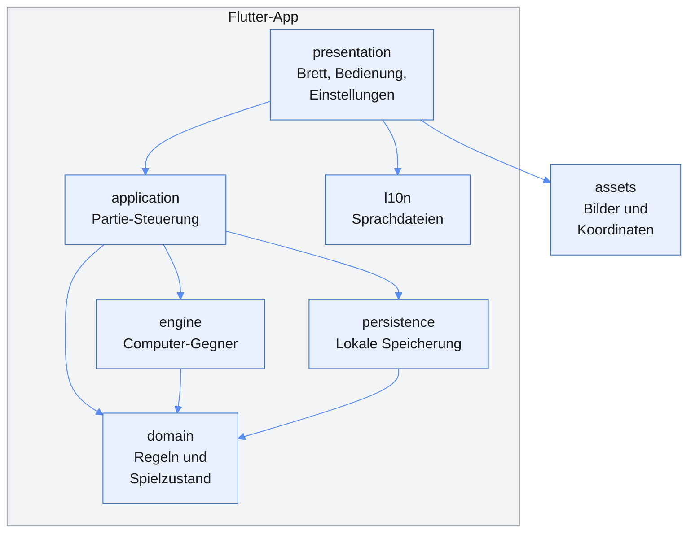
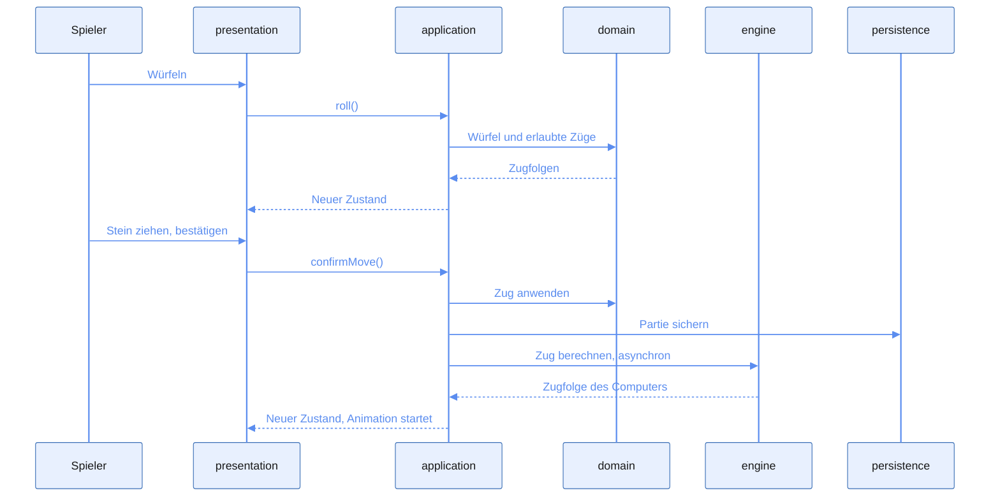
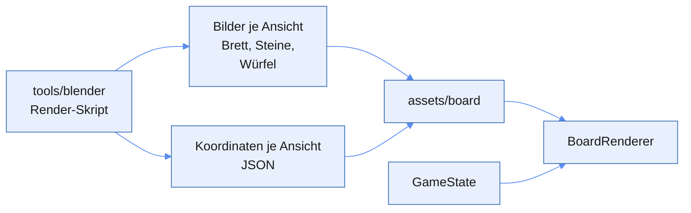

# App-Architektur

Stand: 2026-11-02 · Grundlage: [roadmap-und-anforderungen.md](roadmap-und-anforderungen.md)

Die App besteht aus einer reinen Dart-Logik ohne Flutter-Abhängigkeit und einer dünnen Oberfläche darüber, die vorgerenderte Bilder anhand des Spielstands platziert. Sie läuft vollständig offline.

Umgesetzt sind die Grafik-Pipeline, die Spiellogik in `domain`, die Partie-Steuerung in `application` und die Bedienung am Brett. Bis der Computer-Gegner kommt, bedient der Spieler beide Seiten. `persistence` und `engine` fehlen noch. Dieses Dokument beschreibt den geplanten Aufbau und wird bei jeder Architekturentscheidung aktualisiert. Die Entscheidungen stehen im [Entscheidungslog](#entscheidungslog).

## Überblick



Abhängigkeiten zeigen nur nach unten: `domain` kennt keine andere Schicht, und nur `presentation` kennt Flutter-Widgets.

| Schicht | Aufgabe | Flutter erlaubt | Anforderungen |
| --- | --- | --- | --- |
| `domain` | Spielzustand, erlaubte Züge, Würfel, Dopplerwürfel, Wertung | Nein | `A-101` bis `A-110`, `A-501`, `A-701` |
| `engine` | Stellungsbewertung, Zugwahl, Würfelentscheidungen, Spielstärken | Nein | `A-401` bis `A-406` |
| `application` | Ablauf der Partie, verbindet Spieler, Computer und Speicherung | Nur `ChangeNotifier` | `A-201`, `A-204`, `A-208` |
| `presentation` | Brett zeichnen, Eingaben, Animationen, Ansichtswechsel | Ja | `A-202` bis `A-207`, `A-209`, `A-302` bis `A-305`, `A-502` |
| `persistence` | Laufende Partie, Einstellungen und Statistik sichern | Ja | `A-208`, `A-502` |
| `l10n` | Texte je Sprache | Ja | `A-601`, `A-602` |

## Projektstruktur

```text
lib/
  main.dart
  app/            App-Widget und Design
  domain/         Reines Dart: Regeln und Zustand
  engine/         Reines Dart: Computer-Gegner
  application/    Partie-Steuerung
  presentation/   Bildschirme und Brett
  persistence/    Lokale Speicherung
  l10n/           Sprachdateien
assets/
  board/          Gerenderte Bilder und Koordinaten je Ansicht
test/             Tests, Aufbau wie lib/
tools/
  blender/        Render-Skript; Blender selbst ist von Git ausgeschlossen
  gnubg/          Testwerkzeug GNU Backgammon, wird nie ausgeliefert
docs/             Vision, Anforderungen, Regeln, Architektur
```

## Spielzustand und Regeln

`GameState` ist unveränderlich. Jede Aktion erzeugt einen neuen Zustand, statt den alten zu ändern. Das macht Zurücknehmen, Speichern und die Suche der Engine einfach.

Die Logik ist eine Sammlung reiner Funktionen:

| Baustein | Eingabe | Ausgabe |
| --- | --- | --- |
| Zuggenerator | Zustand, Würfel | Alle erlaubten Zugfolgen |
| Zug anwenden | Zustand, Zugfolge | Neuer Zustand |
| Partieende | Zustand | Sieger, Art des Siegs, Punkte |
| Dopplerwürfel | Zustand, Aktion | Neuer Zustand |

Der Zuggenerator berechnet vollständige Zugfolgen, nicht einzelne Steinbewegungen. Nur so lassen sich die Pflichten prüfen, beide Würfel oder den höheren zu nutzen (`A-107`).

`domain` gibt nie fertige Texte aus, sondern Aufzählungstypen wie `WinType.gammon`. Erst `presentation` macht daraus Text. So bleiben Mehrsprachigkeit und Coach sauber getrennt (`A-701`).

Würfe kommen über eine Schnittstelle `DiceRoller`. Die App nutzt `Random.secure()`, Tests geben feste Würfelfolgen vor. Weder Spielstärke noch Spielstand beeinflussen den Wurf (`A-501`).

## Ablauf eines Zugs



Bis zur Bestätigung hält `application` den Zustand vom Beginn des Zugs, daher ist das Zurücknehmen trivial (`A-204`).

## Brett und Grafik

Das Brett besteht aus vorgerenderten Bildern, nicht aus Echtzeit-3D (`A-301` bis `A-304`).



- **Passgenauigkeit:** Das Render-Skript exportiert neben den Bildern die Bildkoordinaten jedes Steinplatzes und jeder Zunge. Sie stammen aus derselben Kamera, daher passen Steine und Brett exakt zusammen (`A-303`).
- **Vorderer Rahmen:** Er liegt zusammen mit dem Steg vor dem hinteren Fach als eigene transparente Ebene `rail_<ansicht>.png` vor und wird nach den Steinen gezeichnet, dann folgen Würfel und Dopplerwürfel. So verdeckt er die Unterkante der vorderen Steine wie auf einem echten Brett.
- **Steingröße:** Sie ergibt sich aus der Geometrie: Fünf Steine passen auf ein Dreieck, und 15 hochkant stehende Steine füllen ein Fach exakt. Die Steindicke ist deshalb nicht konfigurierbar.
- **Ablagefach:** Für jede Ansicht, Farbe und Anzahl von 1 bis 15 gibt es ein fertiges Bild `off_<ansicht>_<farbe>_<anzahl>.png`, dazu `cube_home_<ansicht>.png` für den Dopplerwürfel im mittleren Fach.
- **Zwei Ansichten:** Für Schwarz und Weiß gibt es je einen Satz Bilder und Koordinaten. Der Spielzustand bleibt gleich, nur der Satz wechselt (`A-304`).
- **Zeichnen:** `BoardPainter` zeichnet Brett, Steine, Würfel und Dopplerwürfel. Die Koordinaten skalieren mit der Bildschirmgröße. Steine weiter vorn liegen über denen dahinter.
- **Eingabe:** Dieselben Koordinaten bestimmen, welche Zunge getroffen wurde. Eingabe und Darstellung können dadurch nicht auseinanderlaufen (`A-203`).

## Computer-Gegner

Die Engine implementiert eine Schnittstelle, damit sie austauschbar bleibt (`A-401`):

```dart
abstract interface class Engine {
  Future<Move> chooseMove(GameState state, Dice dice, Difficulty difficulty);
  Future<CubeDecision> decideCube(GameState state, Difficulty difficulty);
}
```

Die Berechnung darf das Zeichnen nicht blockieren (`A-405`). Auf Android und Windows läuft sie in einem Isolate. Im Web läuft `compute()` auf dem Hauptthread, dort braucht es eine eigene Lösung. Das klärt T4.4.

## Qualität

- **Unit-Tests:** `domain` und `engine` werden ohne Flutter getestet.
- **Referenztests:** `position_id.dart` erzeugt die GNU-Position-ID. `tools/gnubg/update_reference.ps1` lässt GNU Backgammon zu zufälligen und gezielt gesuchten Stellungen alle erlaubten Züge berechnen und schreibt sie nach `test/fixtures/gnubg_legal_plays.json` (`A-702`). GNU Backgammon läuft nur lokal, die Datei wird committet.
- **CI:** GitHub Actions führt `flutter analyze` und `flutter test` aus (T0.5).

## Entscheidungslog

Neue Einträge stehen oben. Eine überholte Entscheidung bleibt stehen und wird als ersetzt markiert.

| Datum | Entscheidung | Grund | Status |
| --- | --- | --- | --- |
| 2026-11-02 | Der gewählte Stein ist ein eigenes gerendertes Sprite, Ziele sind normale Sprites mit Transparenz; die Knopfleiste liegt im aus dem Layout berechneten Filzstreifen | Passt zur 3D-Grafik statt aufgemalter Ringe, und Knöpfe bleiben bei jeder Größe auf dem Filz | Entschieden |
| 2026-11-02 | `GameController` sammelt die Schritte eines Zugs und gibt sie erst bei Zug beenden an `Game`; bis dahin bleibt die Partie unverändert | Zurücknehmen ist damit trivial, und `domain` kennt keine halben Züge | Entschieden |
| 2026-11-02 | `nextSteps` bietet nur Schritte an, die zu einem erlaubten Gesamtzug führen; eine Stellung zählt erst als Ende, wenn kein Würfel mehr spielbar ist | Keine Sackgassen beim Setzen Stein für Stein; dieselbe Stellung kann sonst zu früh als fertig gelten | Entschieden |
| 2026-11-02 | `BoardHitTester` nutzt dieselben Koordinaten und `BoardFit` wie die Darstellung | Tippen und Anzeige können nicht auseinanderlaufen | Entschieden |
| 2026-11-02 | Referenzdaten von GNU Backgammon liegen als feste Datei in `test/fixtures`, zusätzlich zur Stichprobe mit gezielt gesuchten seltenen Stellungen | Die Prüfung läuft ohne GNU Backgammon auf GitHub; eine reine Stichprobe hätte die Regel zum höheren Würfel nicht geprüft | Entschieden |
| 2026-11-02 | Zungen sind aus Sicht von Weiß nummeriert, Bar und Ablage setzen die Skala fort: 25 und 0 für Weiß, 0 und 25 für Schwarz | Ein Zug lässt sich für beide Farben gleich beschreiben | Entschieden |
| 2026-11-02 | Der Zuggenerator liefert vollständige Züge und fasst Züge mit gleicher Endstellung zusammen | Die Zugpflicht lässt sich nur über den ganzen Wurf prüfen | Entschieden |
| 2026-11-02 | Das Licht bleibt an die Kamera gebunden und dreht beim Ansichtswechsel mit | Beide Spieler sehen das Brett gleich gut beleuchtet, und Steine brauchen nur einen Bildersatz | Entschieden |
| 2026-11-02 | App-Symbole entstehen per Skript aus dem Logo; Android nutzt ein adaptives Symbol mit Logo in der Schutzzone | Alle Größen bleiben reproduzierbar, ohne Zusatzpaket; Launcher schneiden die Ecken ab | Entschieden |
| 2026-11-02 | Die App skaliert die Außenkante des Bretts auf die Anzeige; der Tisch ist transparent und fängt nur den Schatten; die Systemleisten sind ausgeblendet | Das Brett nutzt jedes Seitenverhältnis aus, ohne sichtbare Bildkante | Entschieden |
| 2026-11-02 | Fachstapel je Anzahl und der Dopplerwürfel im mittleren Fach sind fertige Bilder aus der echten 3D-Position; Wände verdecken sie, der Fachboden fängt ihre Schatten | Sprites aus der Brettmitte schweben im Fach, weil Blickwinkel und Bodenschatten nicht stimmen | Entschieden |
| 2026-11-02 | Ablagefach mit drei gleichen Fächern; die Steindicke folgt daraus, dass 15 Steine ein Fach exakt füllen; der Steg vor dem hinteren Fach gehört zur oberen Bildebene | Beim Sieg ist das Fach voll, und volle Stapel werden korrekt verdeckt | Entschieden |
| 2026-11-02 | Ablagefach mit Mittelsteg, Maße aus der Steingröße berechnet; herausgespielte Steine sind ein eigenes Sprite ohne Schatten; das Render-Skript bricht ab, wenn 15 Steine nicht passen | Entspricht echten Brettern und bleibt bei geänderten Maßen stimmig | Ersetzt |
| 2026-11-02 | Der vordere Rahmen ist je Ansicht eine eigene transparente Ebene und wird über die Steine gezeichnet; die Steingröße folgt aus fünf Steinen je Dreieck | Steine liegen direkt am Rand und werden verdeckt wie auf einem echten Brett | Entschieden |
| 2026-11-02 | Die Steingröße wird aus Dreieckslänge, Rahmenhöhe und Kameraneigung berechnet, nicht konfiguriert | So passen immer fünf Steine auf ein Dreieck, und der vordere Rahmen verdeckt keinen Stein | Ersetzt |
| 2026-11-02 | Farben, Material, Kamera und Maße stehen in `tools/blender/board_config.json`; ein Render-Lauf erzeugt alle Assets neu | Das Aussehen lässt sich ändern, ohne Code anzufassen | Entschieden |
| 2026-11-02 | Steine und Würfel werden einmal mit Schattenfänger gerendert und je Position nur skaliert; das Licht folgt der Kamera | Spart Bilder, beide Ansichten sehen gleich aus | Entschieden |
| 2026-11-02 | Nur Querformat | Ein Brett ist breiter als hoch und wäre hochkant zu klein | Entschieden |
| 2026-11-02 | Rendering mit portablem Blender 4.5.15 LTS in `tools/blender`, Installation per Skript mit Prüfsumme | LTS bleibt stabil, die Installation bleibt im Workspace und reproduzierbar | Entschieden |
| 2026-11-02 | Texte über `flutter gen-l10n` aus ARB-Dateien in `lib/l10n`, Vorlage ist `app_de.arb`; ein Test prüft `lib` auf fest verdrahtete Texte | Offizieller Flutter-Weg, neue Sprachen brauchen nur eine weitere ARB-Datei | Entschieden |
| 2026-11-02 | Koordinaten kommen als JSON aus dem Render-Skript | Bild und Spiellogik passen exakt zusammen | Entschieden |
| 2026-11-02 | Zustandsverwaltung mit `ChangeNotifier` | Kein Zusatzpaket nötig, reicht für einen Bildschirm mit einer Partie | Entschieden |
| 2026-11-02 | Schichten `domain`, `engine`, `application`, `presentation`, `persistence`, `l10n` | Logik bleibt ohne Oberfläche testbar | Entschieden |
| 2026-11-02 | `GameState` ist unveränderlich | Vereinfacht Zurücknehmen, Speichern und Engine-Suche | Entschieden |
| 2026-11-02 | Vorgerenderte Bilder aus Blender, Ansichten für Schwarz und Weiß, kein Echtzeit-3D | Kein freies Drehen nötig; `flutter_scene` bräuchte den Master-Kanal | Entschieden |
| 2026-11-02 | Eigene Engine in Dart hinter einer Schnittstelle | Läuft auf allen drei Plattformen ohne C-Code | Entschieden |
| 2026-11-02 | GNU Backgammon nur als Testwerkzeug | Prüft Regeln und Bewertungen, ohne die App an C-Code zu binden | Entschieden |
| 2026-11-02 | Keine Server, Konten oder Tracker | Offline zuerst, keine laufenden Kosten | Entschieden |
| 2026-11-02 | Zielplattformen Android, Windows, Web | Vorgabe der Vision | Entschieden |

## Offene Architekturfragen

- [ ] Welches Speicherformat und welches Paket nutzt `persistence`? Vorschlag: JSON über `shared_preferences`. Das Paket braucht eine Freigabe, Task ist T5.1.
- [ ] Wie läuft die Engine im Web, ohne das Zeichnen zu blockieren? Task ist T4.4.
- [ ] Wie groß dürfen die Bilder sein, damit die Web-Version schnell lädt? Das klärt der Prototyp in T1.6.
