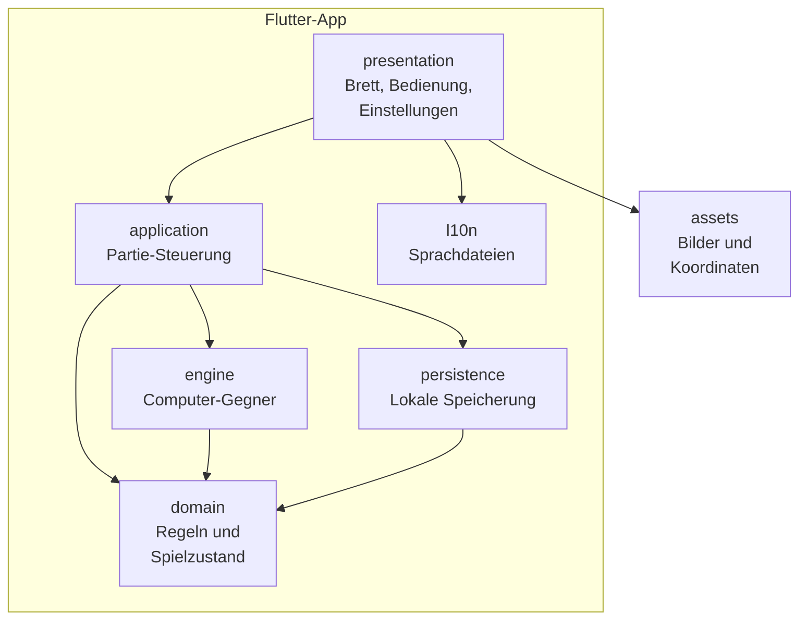
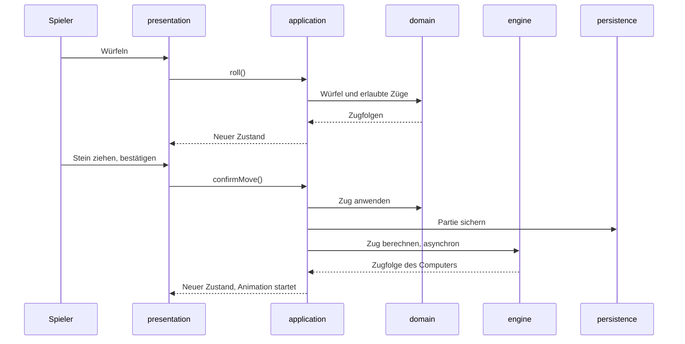
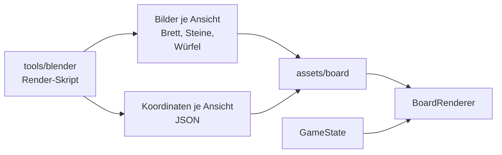

# App-Architektur

Stand: 2026-11-09 · Grundlage: [roadmap-und-anforderungen.md](roadmap-und-anforderungen.md)

Die App besteht aus einer reinen Dart-Logik ohne Flutter-Abhängigkeit und einer dünnen Oberfläche darüber, die vorgerenderte Bilder anhand des Spielstands platziert. Sie läuft vollständig offline.

Umgesetzt sind die Grafik-Pipeline, die Spiellogik in `domain`, der Computer-Gegner in `engine`, die Partie-Steuerung in `application` und die Bedienung am Brett. Partien und Einstellungen sichert `persistence`. Dieses Dokument beschreibt den geplanten Aufbau und wird bei jeder Architekturentscheidung aktualisiert. Die Entscheidungen stehen im [Entscheidungslog](#entscheidungslog).

## Überblick



Abhängigkeiten zeigen nur nach unten: `domain` kennt keine andere Schicht, und nur `presentation` kennt Flutter-Widgets.

| Schicht | Aufgabe | Flutter erlaubt | Anforderungen |
| --- | --- | --- | --- |
| `domain` | Spielzustand, erlaubte Züge, Würfel, Dopplerwürfel, Wertung | Nein | `A-101` bis `A-110`, `A-501`, `A-701` |
| `engine` | Stellungsbewertung, Zugwahl, Würfelentscheidungen, Spielstärken | Nein | `A-401` bis `A-406` |
| `application` | Ablauf der Partie, verbindet Spieler, Computer und Speicherung | Nur `ChangeNotifier` | `A-201`, `A-204`, `A-208` |
| `presentation` | Brett zeichnen, Eingaben, Animationen, Ansichtswechsel | Ja | `A-202` bis `A-207`, `A-209`, `A-302` bis `A-305`, `A-502` |
| `persistence` | Laufende Partie, Einstellungen, Statistik und Bestenliste sichern | Ja | `A-208`, `A-219`, `A-502` |
| `l10n` | Texte je Sprache: Deutsch und Englisch | Ja | `A-601` bis `A-603` |

## Projektstruktur

```text
lib/
  main.dart
  app/            App-Widget und Design
  domain/         Reines Dart: Regeln und Zustand
  engine/         Reines Dart: Computer-Gegner
  application/    Partie-Steuerung
  presentation/   Bildschirme und Brett
  persistence/    Lokale Speicherung
  l10n/           Sprachdateien
assets/
  board/          Gerenderte Bilder und Koordinaten je Ansicht
test/             Tests, Aufbau wie lib/
tools/
  blender/        Render-Skript; Blender selbst ist von Git ausgeschlossen
  gnubg/          Testwerkzeug GNU Backgammon, wird nie ausgeliefert
docs/             Vision, Anforderungen, Regeln, Architektur
```

## Spielzustand und Regeln

`GameState` ist unveränderlich. Jede Aktion erzeugt einen neuen Zustand, statt den alten zu ändern. Das macht Zurücknehmen, Speichern und die Suche der Engine einfach.

Die Logik ist eine Sammlung reiner Funktionen:

| Baustein | Eingabe | Ausgabe |
| --- | --- | --- |
| Zuggenerator | Zustand, Würfel | Alle erlaubten Zugfolgen |
| Zug anwenden | Zustand, Zugfolge | Neuer Zustand |
| Partieende | Zustand | Sieger, Art des Siegs, Punkte |
| Dopplerwürfel | Zustand, Aktion | Neuer Zustand |

Der Zuggenerator berechnet vollständige Zugfolgen, nicht einzelne Steinbewegungen. Nur so lassen sich die Pflichten prüfen, beide Würfel oder den höheren zu nutzen (`A-107`).

`domain` gibt nie fertige Texte aus, sondern Aufzählungstypen wie `WinType.gammon`. Erst `presentation` macht daraus Text. So bleiben Mehrsprachigkeit und Coach sauber getrennt (`A-701`).

Würfe kommen über eine Schnittstelle `DiceRoller`. Die App nutzt `Random.secure()`, Tests geben feste Würfelfolgen vor. Weder Spielstärke noch Spielstand beeinflussen den Wurf (`A-501`).

## Ablauf eines Zugs



Bis zur Bestätigung hält `application` den Zustand vom Beginn des Zugs, daher ist das Zurücknehmen trivial (`A-204`).

## Brett und Grafik

Das Brett besteht aus vorgerenderten Bildern, nicht aus Echtzeit-3D (`A-301` bis `A-304`).



- **Passgenauigkeit:** Das Render-Skript exportiert neben den Bildern die Bildkoordinaten jedes Steinplatzes und jeder Zunge. Sie stammen aus derselben Kamera, daher passen Steine und Brett exakt zusammen (`A-303`).
- **Vorderer Rahmen:** Er liegt zusammen mit dem Steg vor dem hinteren Fach als eigene transparente Ebene `rail_<ansicht>.png` vor und wird nach den Steinen gezeichnet, dann folgen Würfel und Dopplerwürfel. So verdeckt er die Unterkante der vorderen Steine wie auf einem echten Brett.
- **Steingröße:** Sie ergibt sich aus der Geometrie: Fünf Steine passen auf ein Dreieck, und 15 hochkant stehende Steine füllen ein Fach exakt. Die Steindicke ist deshalb nicht konfigurierbar.
- **Ablagefach:** Für jede Ansicht, Farbe und Anzahl von 1 bis 15 gibt es ein fertiges Bild `off_<ansicht>_<farbe>_<anzahl>.png`, dazu `cube_home_<ansicht>.png` für den Dopplerwürfel im mittleren Fach.
- **Zwei Auflösungen:** `render.ps1` rendert alle Bilder in 2560 × 1440 nach `assets/board/` und mit `hd_scale` 1,5 in 3840 × 2160 nach `assets/board/hd/`. Die Koordinaten sind Bruchteile des Bildes und gelten für beide Stufen. `GamePage` lädt die zweite Stufe, sobald das Brett breiter als 2560 physische Pixel gezeichnet wird, und behält bis dahin die normalen Bilder. `pubspec.yaml` nimmt `assets/board/hd/` nur für Web und Windows auf; fehlen die Bilder, lädt `BoardAssets` die normalen (`A-325`).
- **Filz:** Billardgrün `#2D5746`. Seine Struktur entsteht im Render-Skript aus Rauschen und Bump, dazu wahlweise Farbschwankung und ein Webmuster, gesteuert über die `felt_*`-Werte in `board_config.json`. Die Skalen zählen Muster je Brett-Einheit; eine Einheit ist im normalen Bild etwa 32 Pixel breit. Varianten lassen sich ohne Änderung der Datei vergleichen: `BOARD_CONFIG_OVERRIDE` enthält abweichende Werte als JSON, `PREVIEW_NAME` rendert damit eine benannte Vorschau nach `tools/blender/preview/`.
- **Pfeil der Spielrichtung:** `BoardPainter` zeichnet ihn in `brandBlue` aus `lib/presentation/brand.dart` auf den freien Filz aus `BoardLayout.middleBand`, mit Bogen über der äußeren Zunge und Spitze im eigenen Auswurffach (`A-322`).
- **Zwei Ansichten:** Für Schwarz und Weiß gibt es je einen Satz Bilder und Koordinaten. Der Spielzustand bleibt gleich, nur der Satz wechselt (`A-304`).
- **Zeichnen:** `BoardPainter` zeichnet Brett, Steine, Würfel und Dopplerwürfel. Die Koordinaten skalieren mit der Bildschirmgröße. Steine weiter vorn liegen über denen dahinter.
- **Eingabe:** Dieselben Koordinaten bestimmen, welche Zunge getroffen wurde. Eingabe und Darstellung können dadurch nicht auseinanderlaufen (`A-203`).
- **Skalierung der Oberfläche:** `AppScale` in `MaterialApp.builder` legt die App für 900 × 420 dp an und skaliert alles darüber, also Knöpfe, Dialoge und Symbole, mit dem Fenster (`A-318`), nach oben ohne Grenze und nach unten höchstens auf die Hälfte. So bleiben Knöpfe und Dialoge im selben Verhältnis zum Brett, das sich ohnehin anpasst. `VisualDensity.standard` verhindert, dass Flutter sie auf dem Desktop kompakter macht. Rechts bleibt ein Streifen von `BoardPage.toolbarWidth` für die Symbolspalte frei (`A-319`).
- **Rechte Leiste:** Oben stehen Ansicht, Einstellungen und Statistik, unten alle Entscheidungen der laufenden Partie aus `_decisions` (`A-320`). Auf dem Brett erscheinen nur noch Farbwahl, Stufenwahl und Ergebnis, auf dem Filz oder als Popup (`A-313`).
- **Farben:** Das Farbschema entsteht aus der Markenfarbe `brandBlue` (`#5B84C3`) des P2G-Logos in `backgammon_app.dart`, für alle Knöpfe, Symbole und gewählten Auswahlen (`A-321`).
- **Neue Partie:** „Neue Partie“ fragt in `GamePage` erneut nach der Farbe und startet dann mit der eingestellten Stufe (`A-216`).
- **Ziele:** Über jedem durchsichtigen Zielstein malt `BoardPainter` einen Ring in der Gegenfarbe des ziehenden Steins mit einem Rand in dessen Farbe, beim Auswürfeln einen Rahmen um das Fach (`A-314`). Größe und Lage des Rings folgen aus dem Sprite-Rahmen des Steins, damit er in jeder Perspektive passt.
- **Spielrichtung:** Beim Start einer Partie läuft in `GamePage` eine Animation von vier Sekunden. Solange sie läuft, trägt `BoardScene` den Spieler und die Deckkraft, und `BoardPainter` zeichnet ein liegendes U durch die mittleren Steinplätze der Zungen 24, 13, 12 und 1 (für Schwarz umgekehrt). Das letzte Viertel blendet aus (`A-322`).
- **Holz:** Der Rahmen nutzt die Holzfarben `frame_wood_light` und `frame_wood_dark` aus `board_config.json`, ein helles Birnenholz (`A-323`).

## Plattformen und Datenschutz

- **Android:** Sicherung und Geräteübertragung sind über `allowBackup="false"` und `data_extraction_rules.xml` abgeschaltet (`A-807`). Das Release-APK fordert keine Internetberechtigung an.
- **Android-Signatur:** Google signiert die App über Play App Signing. Signiert wird mit dem Upload-Schlüssel `upload`, der außerhalb des Repos liegt. Auf ihn verweist `android/key.properties`, und die Datei steht in `.gitignore`. Fehlt sie, etwa in der CI, signiert der Release-Build mit dem Debug-Schlüssel, und das Bundle lässt sich nicht hochladen.
- **Windows:** `shared_preferences` schreibt nach `%APPDATA%\Achim Gerber\Backgammon\shared_preferences.json`. Firmen- und Produktname kommen aus `windows/runner/Runner.rc`.
- **Web:** Die App bekommt keinen `SessionStore`, sie speichert also nichts im Browser (`A-808`). Ohne `SessionStore` führt `GameController` auch keine Bestenliste, und der Statistik-Dialog zeigt nur die Würfel.
- **Rechtstexte:** `legal_page.dart` zeigt aus `assets/legal/*.md` nur die Abschnitte der laufenden Plattform, in der Sprache der Oberfläche: `privacy_<sprache>.md` und `imprint_<sprache>.md` mit `de` oder `en` aus `AppLocalizations.localeName`. Abschnitte stehen zwischen `<!-- nur: android, windows -->` und `<!-- ende -->`. Die Logik dafür liegt ohne Flutter in `lib/legal/legal_text.dart`.
- **Rechtstexte im Web:** `tools/legal/build_pages.dart` erzeugt daraus mit den Abschnitten aller Plattformen eigenständige Seiten in `web/`: `impressum.html` und `datenschutz.html`, auf Englisch `imprint.html` und `privacy.html` (`A-809`, `A-604`). Die Datenschutzerklärung dient damit auch als öffentlicher Link für Google Play. Der Workflow `.github/workflows/pages.yml` prüft, baut mit `--no-web-resources-cdn --base-href /backgammon/` und veröffentlicht jeden Stand auf `main` über GitHub Pages. Der Web-Build kopiert sie neben die App. Ein Test schlägt fehl, wenn eine Seite nicht mehr zum Text passt.

## Computer-Gegner

Die Engine implementiert eine Schnittstelle, damit sie austauschbar bleibt (`A-401`):

```dart
abstract interface class Engine {
  Future<Play> choosePlay(Board board, Player player, Dice dice, Difficulty difficulty);
  Future<bool> wantsToDouble(Game game, Difficulty difficulty);
  Future<bool> acceptsDouble(Game game, Difficulty difficulty);
}
```

`HeuristicEngine` bewertet die Stellung nach jedem erlaubten Zug mit `evaluate` und wählt die beste. Die Bewertung nutzt Rennstand, Punkte, Prime, Blots, Treffergefahr und weitere Merkmale. Ihre Gewichte stimmt `tools/engine/tune.dart` gegen Referenzbewertungen von GNU Backgammon ab, auf einer Hälfte der Stellungen, gemessen auf der anderen.

Die drei Stufen unterscheiden sich durch einen gezielten Zufallsfehler in der Bewertung. Leicht macht zusätzlich in der Hälfte der Züge einen typischen Anfängerfehler, wenn der Wurf einen zulässt. `mistakes.dart` erkennt diese Fehler im Vergleich zum besten Zug: ausgelassener Treffer, aufgebrochener Punkt, ungeschützter Stein, zu früh tief in die Heimat. Daraus kann später der Coach schöpfen (`T7.2`). Würfelentscheidungen vergleichen eine geschätzte Gewinnchance mit je Stufe festen Schwellen; Leicht doppelt erst ab 95 % und nimmt ab 10 % an.

`tools/engine/compare_levels.dart` misst die Stufen gegeneinander und gegen zwei einfache Gegner aus `tools/engine/players.dart`: einen Zufallsspieler und einen Anfängerspieler, der die hinteren Steine vorzieht. Diese Gegner gehören nicht zur App. Stand 2026-11-03, je 300 Partien:

| Paarung | Gewonnene Partien |
| --- | --- |
| Schwer gegen Mittel | 174 bis 199 (58 bis 66 %) |
| Mittel gegen Leicht | 296 (99 %) |
| Anfänger gegen Leicht | 137 (46 %), vorher 46 (15 %) |
| Anfänger gegen Mittel | 12 (4 %) |
| Zufall gegen Leicht | 41 (14 %) |

**Zu Ende spielen:** Ohne Kontakt spielt `GameController` beide Seiten nicht mit der `Engine`, sondern mit `racePlay` aus `lib/engine/race.dart` (`A-410`). Sie bewertet streng geordnet: zuerst ausgewürfelte Steine, dann die Zahl der Quadrantenwechsel bis ins Heimfeld, zuletzt die Pips mit den Korrekturen der Keith-Zählung für Stapel auf den untersten Punkten und Lücken auf den Punkten 4 bis 6. In 200 zufälligen Rennen braucht sie 13,1 Würfe bis zum Ende, die Stufe Schwer 15,5: Deren Bewertung zieht ausgewürfelte Pips ab und zieht deshalb lieber innerhalb des Heimfelds. Die Spielstufen selbst bleiben unverändert.

`GameController` führt die Züge des Computers aus. Pausen zwischen den Schritten machen sie nachvollziehbar, und eine Partienummer verhindert, dass ein alter Lauf in eine neue Partie hineinwirkt.

## Spielfluss

`GamePace` in `lib/application/game_pace.dart` legt je Stufe die Wartezeit für Entscheidungen und die Pause zwischen den Zügen des Computers fest (`A-220`). `GameController` startet jede automatische Aktion über `_startCountdown` und legt sie als `Countdown` offen: Aktion, Start und Dauer. `GamePage` zeichnet daraus mit `CountdownRing` einen ablaufenden Ring auf den Rand des passenden Symbols, ohne es zu vergrößern (`A-222`). `HintedButton` setzt einen Hinweis als Sprechblase links neben sein Symbol. Die Sprechblase liegt über `OverlayPortal` in der Overlay-Ebene und folgt dem Symbol mit `CompositedTransformFollower`; so behält die Leiste ihre Breite, und die Wahlmöglichkeiten darin bleiben antippbar (`A-223`). Wo es keine Wahl gibt, entfällt die Wartezeit (`A-221`): Hat `Game.plays` nur einen Eintrag, endet der Zug mit dem letzten Stein; darf der Spieler nicht doppeln, würfelt die App nach 0,4 Sekunden. Mit `autoForced` setzt `_playForced` einen solchen Zug selbst; solange sperrt `playingForced` die Eingabe (`A-224`). Der Dopplerwürfel steht rechts, solange `mayDouble` gilt; `requestDouble` doppelt sofort oder merkt den Wunsch vor, und `asksToDouble` hält dann das automatische Würfeln an und zeigt die Nachfrage auf dem Filz (`A-225`). Der Wunsch wird nicht gespeichert. Tests geben Wartezeit und Computerpause weiter fest vor; ohne Vorgabe folgt die Pause dem Tempo.

## Bestenliste

`GameController` legt jede beendete Partie gegen den Computer als `GameRecord` in `GameRecords` aus `lib/persistence/game_records.dart` ab: Datum, Stufe, Farbe, Spielzeit und Punkte beider Seiten (`A-219`). Die Liste behält die letzten 100 Partien, neueste zuerst; die Gesamtpunkte je Stufe zählen getrennt weiter, auch für Partien, die aus der Liste fallen. Die Spielzeit läuft ab dem Start der Partie und wird mit jedem Sichern in `Session.playSeconds` festgehalten; nach einem Neustart läuft sie von dort weiter, die Zeit bei geschlossener App zählt also nicht. Eine Uhr lässt sich für Tests über `clock` vorgeben. Ein Stand aus Version 1.0 ohne Bestenliste lädt mit leerer Liste. Der Statistik-Dialog schaltet mit einem `SegmentedButton` zwischen Würfelstatistik und Bestenliste um.

## Sprachen

Vorlage ist `app_de.arb`, dazu kommt `app_en.arb`. `appLocale` in `backgammon_app.dart` wählt über `localeListResolutionCallback` Deutsch, wenn die erste Systemsprache Deutsch ist, sonst Englisch (`A-603`). In den Einstellungen lässt sich die Sprache wählen (`A-605`): Zwei Flaggen in der Titelzeile, denn eine weitere Zeile passte auf dem Handy nicht ohne Scrollen. Die Flagge der Gerätesprache speichert „System“, die andere die feste Sprache. `LanguageFlag` zeichnet die Flaggen selbst, weil Windows Emoji-Flaggen nur als Buchstaben zeigt; die Titelzeile ist deshalb senkrecht zentriert statt an der Schriftlinie ausgerichtet. Die Wahl liegt als Sprachcode in `GameController.language`, einem eigenen `ValueListenable`, und wird mit der `Session` gesichert. `BackgammonApp` erzeugt dafür den `GameController` selbst, reicht ihn an `GamePage` weiter und baut `MaterialApp` nur bei einem Sprachwechsel neu auf. Ohne diese Regel nähme Flutter bei einer nicht unterstützten Sprache die erste unterstützte, also Deutsch. `test/flutter_test_config.dart` setzt die Systemsprache in allen Tests auf Deutsch, damit sie die deutschen Texte nennen können; Tests für Englisch setzen ihre Sprache selbst. Datum und Uhrzeit formatiert `intl` in der Sprache der Oberfläche.

## App-Symbol

`tools/icon/render_icon_art.py` rendert das Motiv mit dem P2G-Logo in Blender, `tools/icon/render_icon.py` erzeugt daraus alle Größen für Android, Web, Windows und das Store-Symbol `docs/store/icon_512.png`. Für das adaptive Android-Symbol schrumpft das Motiv auf 70 % der 108 dp auf einem Grund in der Markenfarbe. So bleibt das Logo innerhalb der Schutzzone von 66 dp Durchmesser, die jede Maskenform zeigt, und das Motiv deckt die höchstens 72 dp sichtbare Fläche noch ganz ab. `test/app/app_icon_test.dart` misst die weißen Pixel des Logos in den fertigen Bildern (`A-326`).

## Qualität

- **Unit-Tests:** `domain` und `engine` werden ohne Flutter getestet.
- **Referenztests:** `position_id.dart` erzeugt die GNU-Position-ID. `tools/gnubg/update_reference.ps1` lässt GNU Backgammon zu zufälligen und gezielt gesuchten Stellungen alle erlaubten Züge berechnen und schreibt sie nach `test/fixtures/gnubg_legal_plays.json` (`A-702`). GNU Backgammon läuft nur lokal, die Datei wird committet.
- **CI:** GitHub Actions führt `flutter analyze` und `flutter test` aus (T0.5).

## Entscheidungslog

Neue Einträge stehen oben. Eine überholte Entscheidung bleibt stehen und wird als ersetzt markiert.

| Datum | Entscheidung | Grund | Status |
| --- | --- | --- | --- |
| 2026-11-09 | Spieltempo in Stufen statt einer Wartezeit in Sekunden; ohne Wahl keine Wartezeit; Countdown als Ring; Pflichtzüge auf Wunsch automatisch | Vorschlag zum Spielfluss: Eine Runde hatte rund 6 Sekunden Leerlauf, auch wenn es nichts zu entscheiden gab. Die Stufe „Gemütlich“ heißt „Ruhig“, weil sonst die Einstellungen auf dem Handy nicht ohne Scrollen passten | Entschieden |
| 2026-11-09 | Die Sprache ist in den Einstellungen über zwei gezeichnete Flaggen wählbar, ohne eigene Option „System“; `BackgammonApp` besitzt dafür den `GameController` und hört nur auf dessen `language`; `appLocale` liegt in `lib/l10n/app_locale.dart` | Wunsch beim Testen; ein eigenes Listenable verhindert, dass jeder Zug die ganze App neu aufbaut; `presentation` braucht `appLocale`, ohne `app` zu importieren | Entschieden |
| 2026-11-09 | Im adaptiven Android-Symbol füllt das Motiv 70 statt 85 % der Fläche; das Logo ist 8 % kleiner | Gemessen reichte das Logo 36,9 dp weit, die Schutzzone der Masken nur 33 dp; runde Masken schnitten die Spitze ab. 8 % kleiner allein hätte nicht gereicht | Entschieden |
| 2026-11-09 | Englisch über `app_en.arb` und eigene Rechtstexte `*_en.md`; Deutsch nur bei deutscher Systemsprache, sonst Englisch; Tests laufen über `flutter_test_config.dart` auf Deutsch | Offizieller Flutter-Weg ohne neues Paket; die bestehenden Tests bleiben unverändert | Entschieden |
| 2026-11-09 | Bestenliste als `GameRecords` in der `Session` von `persistence`, letzte 100 Partien und Gesamtpunkte je Stufe; nicht in der Web-Version; im bestehenden Statistik-Dialog | Ein JSON-Dokument wie bisher, ohne Schema-Änderung für alte Stände; die Web-Version bleibt ohne Speicher (`A-808`) | Entschieden |
| 2026-11-09 | „Zu Ende spielen“ nutzt die eigene Rennbewertung `racePlay` statt der Engine | Rückmeldung eines Benutzers: Die Engine zog im Heimfeld, statt auszuwürfeln. Ohne Kontakt gibt es nur noch das Ziel, schnell fertig zu werden; die Rennbewertung braucht 13,1 statt 15,5 Würfe. Ergänzt den Eintrag vom 2026-11-02 zu „Zu Ende spielen“ | Entschieden |
| 2026-11-04 | Store-Screenshots und Vorstellungsgrafik entstehen mit `tools/store/store_graphics_test.dart` als Widget-Test aus der echten `GamePage`, mit `appTheme()`, Roboto und den Material-Symbolen; das Theme steht dafür in einer eigenen Funktion | Feste Spielsituationen ohne Gerät und ohne Tippen im Emulator; ein erneuter Lauf erzeugt nach jeder Änderung der Oberfläche passende Bilder. Der Lauf fand eine echte Lücke: Die Knöpfe im Popup verloren die App-Schrift | Entschieden |
| 2026-11-04 | Zweite Bildstufe 3840 × 2160 in `assets/board/hd/`, nur für Web und Windows; geladen erst, wenn das Brett breiter als 2560 physische Pixel gezeichnet wird | Auf einem 4K-Bildschirm wirkte das hochskalierte Brett unscharf. 1,5-fach deckt 4K vollständig ab und kostet ein Viertel der Daten von 2-fach; Handys erreichen die Schwelle nicht, deshalb wächst die Android-App nicht | Entschieden |
| 2026-11-04 | Die App-Version steht als Konstante in `lib/app/app_version.dart`, ein Test vergleicht sie mit `pubspec.yaml` | Kein zusätzliches Paket wie `package_info_plus`; eine vergessene Anpassung fällt im Test auf | Entschieden |
| 2026-11-04 | Situationsabhängige Symbole der rechten Leiste nutzen `situationalButtonStyle` aus `game_page.dart`: weiß mit blauem Symbol; feste Symbole und Dialoge behalten die Theme-Farben | Praxistest P-14: Eine neue Entscheidung wie „Kein Zug möglich“ fiel zwischen den festen Symbolen nicht auf und wirkte wie ein Hänger. Ergänzt die Farbwahl vom 2026-11-03 | Entschieden |
| 2026-11-04 | Englisch kommt als Zwischenrelease 1.1.0 in der neuen Delivery D7; der Coach wird zu D8 | Das Release 1.0.0 hängt nicht an übersetzten Rechtstexten und gegengelesenen Fachbegriffen | Entschieden |
| 2026-11-04 | Öffentliche Kontaktadresse ist `apps@passion-to-grow.com`; die Seiten zeigen E-Mail-Adressen als Text ohne `mailto:`-Link | Die persönliche Adresse und das Play-Console-Login bleiben privat; einfache Adresssammler finden die Adresse schlechter, die Pflichtangabe im Impressum bleibt erfüllt | Entschieden |
| 2026-11-03 | Die Web-Version wird per GitHub Actions bei jedem Push auf `main` nach Analyse und Tests auf GitHub Pages veröffentlicht; die Rechtstexte-Seiten enthalten die Abschnitte aller Plattformen | Kein eigener Server und kein manueller Upload; Google Play braucht die Android-Abschnitte unter einem öffentlichen Link | Entschieden |
| 2026-11-03 | Versionierung folgt der Roadmap: vor dem Release `0.D.n` mit der laufenden Delivery `D`, Release von Version 1 als `1.0.0`; die Build-Nummer steigt mit jedem weitergegebenen Build und wird nie zurückgesetzt; einzige Quelle ist `pubspec.yaml` | An der Version ist abzulesen, wie weit die Roadmap ist, und `1.0.0` bedeutet wirklich veröffentlicht. Google Play verlangt einen steigenden `versionCode` | Entschieden |
| 2026-11-03 | Ziele bekommen zusätzlich einen aufgemalten Ring in der Gegenfarbe; die Spielrichtung zeigt zu Beginn ein aufgemalter Pfeil; der Rahmen ist hellbraunes Birnenholz | Praxistest P-11 bis P-13: Durchsichtige Steine verschwanden auf hellen Zungen und hellen Steinen. Ring und Pfeil hängen von Zustand und Fenstergröße ab und werden deshalb gezeichnet, nicht gerendert. Ergänzt den Eintrag vom 2026-11-02 zu den Zielen | Entschieden |
| 2026-11-03 | Play App Signing mit eigenem Upload-Schlüssel je App außerhalb des Repos; Gradle liest ihn über `android/key.properties` und nimmt ohne die Datei den Debug-Schlüssel | Das Repo ist öffentlich. Einen verlorenen Upload-Schlüssel kann Google zurücksetzen, und CI sowie `flutter run --release` laufen ohne den Schlüssel | Entschieden |
| 2026-11-03 | Knöpfe in der Markenfarbe `#5B84C3` aus `icon.png` statt der Töne des Brett-Symbols; Aufgeben immer zuunterst | Praxistest P-9: Marke wiedererkennbar, und das unterste Symbol springt nicht. Ersetzt die Farbwahl im Eintrag darunter | Entschieden |
| 2026-11-03 | Entscheidungen im Spiel stehen als Symbole unten in der rechten Leiste statt auf dem Brett; die Farben kommen aus dem App-Symbol | Praxistest P-8: Popups verdeckten im Spiel das Brett. Die Leiste hat auf jedem Bildschirm Platz und ändert ihre Lage nicht | Entschieden |
| 2026-11-03 | `AppScale` ohne Obergrenze, nur mit Untergrenze 0,5; `VisualDensity.standard` auf allen Plattformen; Einstellungen in zwei Spalten, Rechtstexte neben Schließen | Praxistest P-7 unter Windows: Das maximierte Fenster brauchte Faktor 2,4, auf dem Desktop waren Knöpfe kompakter, und der Dialog musste scrollen. Ersetzt die Grenze 1,5 aus dem Eintrag darunter | Entschieden |
| 2026-11-03 | Rechtstexte für GitHub Pages werden aus `assets/legal/` als statisches HTML in `web/` erzeugt und committet, ein Test prüft den Gleichstand | Eine Quelle für App und Webseite; die Seite ist ohne JavaScript lesbar und lädt nichts von fremden Servern | Entschieden |
| 2026-11-03 | Leicht macht in der Hälfte der Züge einen erkennbaren Anfängerfehler und doppelt erst ab 95 %, nimmt ab 10 % an; Mittel und Schwer bleiben gleich | Praxistest P-4: Gegen Leicht war kaum ein Sieg möglich. Ein Anfängerspieler gewinnt jetzt 46 % statt 15 % | Entschieden |
| 2026-11-03 | Die Oberfläche skaliert als Ganzes mit dem Fenster über `AppScale`, Bezug 900 × 420 dp, Faktor 0,5 bis 1,5; rechts bleibt Platz für die Symbole | Praxistest P-1 und P-3: Im kleinen Fenster waren Dialoge unbrauchbar und Symbole lagen auf dem Brett. Ein Faktor für alles hält die Proportionen | Obergrenze ersetzt am 2026-11-03 |
| 2026-11-03 | Die Web-Version speichert nichts; Android schließt Sicherung und Geräteübertragung aus; Rechtstexte zeigen nur die Abschnitte der eigenen Plattform | Klare, prüfbare Aussagen in der Datenschutzerklärung ohne Einwilligung für Browserspeicher | Entschieden |
| 2026-11-03 | Führen bei einem kombinierten Zug zwei Reihenfolgen ans Ziel, gewinnt die mit den meisten Schlägen | Praxistest: Schlagen unterwegs ist fast immer der bessere Zug und wird erwartet; ersetzt die Regel „wenigste Schläge“ vom 2026-11-02 | Entschieden |
| 2026-11-02 | Die Würfel werden auf kleinen Bildschirmen beim Zeichnen doppelt so groß skaliert, nach demselben Kriterium wie das Popup | Kein zweiter Schwellenwert und keine zusätzlichen Render-Dateien; Würfel und Popup schalten immer gemeinsam um | Entschieden |
| 2026-11-02 | Unter 48 dp Knopfhöhe auf dem Filz wechselt die Knopfleiste zu einem Popup in fester Größe | Am Handy war die skalierte Leiste nicht lesbar; große Bildschirme behalten die Leiste auf dem Filz | Entschieden |
| 2026-11-02 | Rechtstexte liegen als Dateien in `assets/legal/`, nicht in den ARB-Dateien; die Web-Version wird mit `--no-web-resources-cdn` gebaut und bringt Roboto selbst mit | Lange Texte bleiben pflegbar und gelten offline; ohne Google-Server gehen keine IP-Adressen dorthin | Entschieden |
| 2026-11-02 | Kombinierte Züge sind eine Folge einzelner `Step`s aus `pathsFrom` auf Basis von `nextSteps`; bei zwei Reihenfolgen gewinnt die mit den wenigsten Schlägen | Keine zweite Regelprüfung, Zurücknehmen bleibt einzeln möglich, und niemand schlägt unbeabsichtigt | Reihenfolge ersetzt am 2026-11-03 |
| 2026-11-02 | Der Stand liegt als ein JSON-Dokument in `shared_preferences`, Speichervorgänge laufen nacheinander; ein beschädigter Stand zählt als keiner | Einfach und ohne Schema; ein älterer Stand kann keinen neueren überschreiben, und die App startet in jedem Fall | Entschieden |
| 2026-11-02 | Gesichert wird nach jedem abgeschlossenen Zug samt gewürfelter Zahlen, halbe Züge nicht | Ein Neustart kann keinen Wurf ändern | Entschieden |
| 2026-11-02 | „Zu Ende spielen“ nutzt die Abläufe des Computers für beide Seiten; `Board.hasContact` bestimmt, ab wann das angeboten wird | Keine zweite Spiel-Logik, und ohne Kontakt gibt es keine Entscheidungen mehr, die dem Spieler fehlen könnten | Zugwahl ergänzt am 2026-11-09 |
| 2026-11-02 | Keine Vorausschau über die Antworten des Gegners; die Engine bewertet nur die Stellung nach dem eigenen Zug | Vorausschau senkte den Fehler nicht (0,039 statt 0,035 Equity) und brachte im Spiel keinen Vorteil; ohne sie ist die Rechnung kurz genug für alle Plattformen, ein Isolate oder eine Aufteilung ist nicht nötig | Entschieden |
| 2026-11-02 | Stufen entstehen durch gezielten Zufallsfehler in der Bewertung: 0,5 / 0,18 / 0 | Gemessen in je 300 Partien und zwei Läufen: Schwer schlägt Mittel zu 60 bis 64 %, Mittel schlägt Leicht zu 73 bis 76 % | Für Leicht ergänzt am 2026-11-03 |
| 2026-11-02 | Der gewählte Stein ist ein eigenes gerendertes Sprite, Ziele sind normale Sprites mit Transparenz; die Knopfleiste liegt im aus dem Layout berechneten Filzstreifen | Passt zur 3D-Grafik statt aufgemalter Ringe, und Knöpfe bleiben bei jeder Größe auf dem Filz | Entschieden |
| 2026-11-02 | `GameController` sammelt die Schritte eines Zugs und gibt sie erst bei Zug beenden an `Game`; bis dahin bleibt die Partie unverändert | Zurücknehmen ist damit trivial, und `domain` kennt keine halben Züge | Entschieden |
| 2026-11-02 | `nextSteps` bietet nur Schritte an, die zu einem erlaubten Gesamtzug führen; eine Stellung zählt erst als Ende, wenn kein Würfel mehr spielbar ist | Keine Sackgassen beim Setzen Stein für Stein; dieselbe Stellung kann sonst zu früh als fertig gelten | Entschieden |
| 2026-11-02 | `BoardHitTester` nutzt dieselben Koordinaten und `BoardFit` wie die Darstellung | Tippen und Anzeige können nicht auseinanderlaufen | Entschieden |
| 2026-11-02 | Referenzdaten von GNU Backgammon liegen als feste Datei in `test/fixtures`, zusätzlich zur Stichprobe mit gezielt gesuchten seltenen Stellungen | Die Prüfung läuft ohne GNU Backgammon auf GitHub; eine reine Stichprobe hätte die Regel zum höheren Würfel nicht geprüft | Entschieden |
| 2026-11-02 | Zungen sind aus Sicht von Weiß nummeriert, Bar und Ablage setzen die Skala fort: 25 und 0 für Weiß, 0 und 25 für Schwarz | Ein Zug lässt sich für beide Farben gleich beschreiben | Entschieden |
| 2026-11-02 | Der Zuggenerator liefert vollständige Züge und fasst Züge mit gleicher Endstellung zusammen | Die Zugpflicht lässt sich nur über den ganzen Wurf prüfen | Entschieden |
| 2026-11-02 | Das Licht bleibt an die Kamera gebunden und dreht beim Ansichtswechsel mit | Beide Spieler sehen das Brett gleich gut beleuchtet, und Steine brauchen nur einen Bildersatz | Entschieden |
| 2026-11-02 | App-Symbole entstehen per Skript aus dem Logo; Android nutzt ein adaptives Symbol mit Logo in der Schutzzone | Alle Größen bleiben reproduzierbar, ohne Zusatzpaket; Launcher schneiden die Ecken ab | Entschieden |
| 2026-11-02 | Die App skaliert die Außenkante des Bretts auf die Anzeige; der Tisch ist transparent und fängt nur den Schatten; die Systemleisten sind ausgeblendet | Das Brett nutzt jedes Seitenverhältnis aus, ohne sichtbare Bildkante | Entschieden |
| 2026-11-02 | Fachstapel je Anzahl und der Dopplerwürfel im mittleren Fach sind fertige Bilder aus der echten 3D-Position; Wände verdecken sie, der Fachboden fängt ihre Schatten | Sprites aus der Brettmitte schweben im Fach, weil Blickwinkel und Bodenschatten nicht stimmen | Entschieden |
| 2026-11-02 | Ablagefach mit drei gleichen Fächern; die Steindicke folgt daraus, dass 15 Steine ein Fach exakt füllen; der Steg vor dem hinteren Fach gehört zur oberen Bildebene | Beim Sieg ist das Fach voll, und volle Stapel werden korrekt verdeckt | Entschieden |
| 2026-11-02 | Ablagefach mit Mittelsteg, Maße aus der Steingröße berechnet; herausgespielte Steine sind ein eigenes Sprite ohne Schatten; das Render-Skript bricht ab, wenn 15 Steine nicht passen | Entspricht echten Brettern und bleibt bei geänderten Maßen stimmig | Ersetzt |
| 2026-11-02 | Der vordere Rahmen ist je Ansicht eine eigene transparente Ebene und wird über die Steine gezeichnet; die Steingröße folgt aus fünf Steinen je Dreieck | Steine liegen direkt am Rand und werden verdeckt wie auf einem echten Brett | Entschieden |
| 2026-11-02 | Die Steingröße wird aus Dreieckslänge, Rahmenhöhe und Kameraneigung berechnet, nicht konfiguriert | So passen immer fünf Steine auf ein Dreieck, und der vordere Rahmen verdeckt keinen Stein | Ersetzt |
| 2026-11-02 | Farben, Material, Kamera und Maße stehen in `tools/blender/board_config.json`; ein Render-Lauf erzeugt alle Assets neu | Das Aussehen lässt sich ändern, ohne Code anzufassen | Entschieden |
| 2026-11-02 | Steine und Würfel werden einmal mit Schattenfänger gerendert und je Position nur skaliert; das Licht folgt der Kamera | Spart Bilder, beide Ansichten sehen gleich aus | Entschieden |
| 2026-11-02 | Nur Querformat | Ein Brett ist breiter als hoch und wäre hochkant zu klein | Entschieden |
| 2026-11-02 | Rendering mit portablem Blender 4.5.15 LTS in `tools/blender`, Installation per Skript mit Prüfsumme | LTS bleibt stabil, die Installation bleibt im Workspace und reproduzierbar | Entschieden |
| 2026-11-02 | Texte über `flutter gen-l10n` aus ARB-Dateien in `lib/l10n`, Vorlage ist `app_de.arb`; ein Test prüft `lib` auf fest verdrahtete Texte | Offizieller Flutter-Weg, neue Sprachen brauchen nur eine weitere ARB-Datei | Entschieden |
| 2026-11-02 | Koordinaten kommen als JSON aus dem Render-Skript | Bild und Spiellogik passen exakt zusammen | Entschieden |
| 2026-11-02 | Zustandsverwaltung mit `ChangeNotifier` | Kein Zusatzpaket nötig, reicht für einen Bildschirm mit einer Partie | Entschieden |
| 2026-11-02 | Schichten `domain`, `engine`, `application`, `presentation`, `persistence`, `l10n` | Logik bleibt ohne Oberfläche testbar | Entschieden |
| 2026-11-02 | `GameState` ist unveränderlich | Vereinfacht Zurücknehmen, Speichern und Engine-Suche | Entschieden |
| 2026-11-02 | Vorgerenderte Bilder aus Blender, Ansichten für Schwarz und Weiß, kein Echtzeit-3D | Kein freies Drehen nötig; `flutter_scene` bräuchte den Master-Kanal | Entschieden |
| 2026-11-02 | Eigene Engine in Dart hinter einer Schnittstelle | Läuft auf allen drei Plattformen ohne C-Code | Entschieden |
| 2026-11-02 | GNU Backgammon nur als Testwerkzeug | Prüft Regeln und Bewertungen, ohne die App an C-Code zu binden | Entschieden |
| 2026-11-02 | Keine Server, Konten oder Tracker | Offline zuerst, keine laufenden Kosten | Entschieden |
| 2026-11-02 | Zielplattformen Android, Windows, Web | Vorgabe der Vision | Entschieden |

## Offene Architekturfragen

- [ ] Wie groß dürfen die Bilder sein, damit die Web-Version schnell lädt? Das klärt der Prototyp in T1.6.
