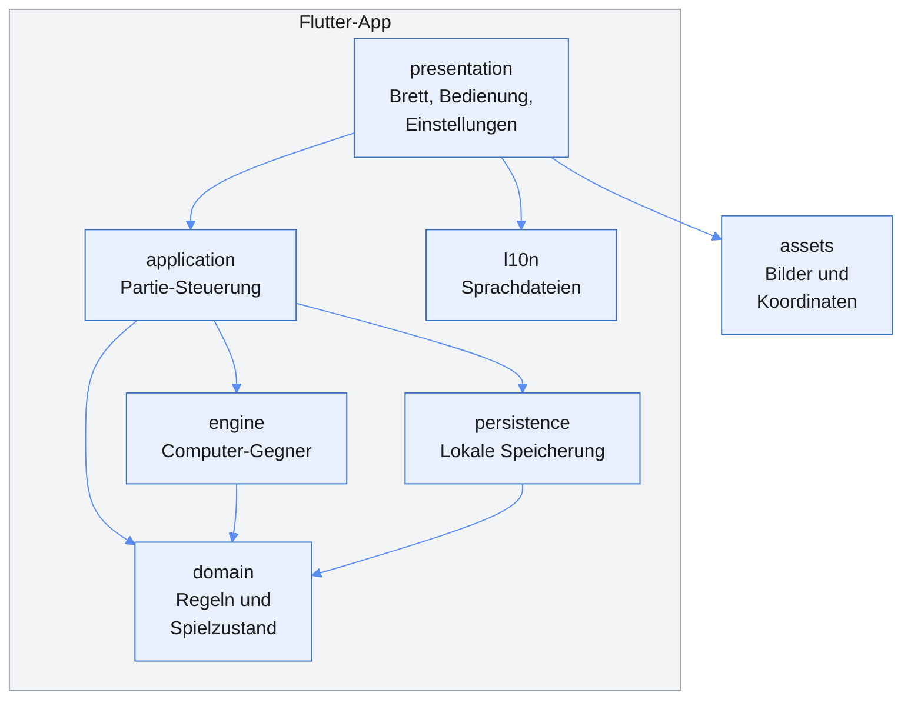
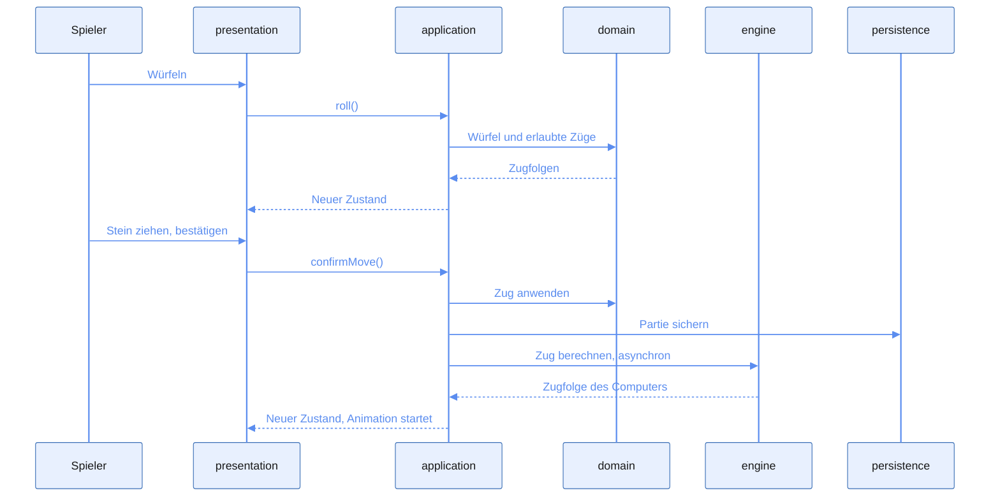
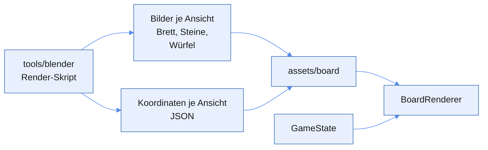

# App-Architektur

Stand: 2026-11-02 · Grundlage: [anforderungen.md](anforderungen.md)

Die App besteht aus einer reinen Dart-Logik ohne Flutter-Abhängigkeit und einer dünnen Oberfläche darüber, die vorgerenderte Bilder anhand des Spielstands platziert. Sie läuft vollständig offline.

Bisher ist nur das Gerüst von `flutter create` umgesetzt. Dieses Dokument beschreibt den geplanten Aufbau und wird bei jeder Architekturentscheidung aktualisiert. Die Entscheidungen stehen im [Entscheidungslog](#entscheidungslog).

## Überblick



Abhängigkeiten zeigen nur nach unten: `domain` kennt keine andere Schicht, und nur `presentation` kennt Flutter-Widgets.

| Schicht | Aufgabe | Flutter erlaubt | Anforderungen |
| --- | --- | --- | --- |
| `domain` | Spielzustand, erlaubte Züge, Würfel, Dopplerwürfel, Wertung | Nein | `A-101` bis `A-110`, `A-501`, `A-701` |
| `engine` | Stellungsbewertung, Zugwahl, Würfelentscheidungen, Spielstärken | Nein | `A-401` bis `A-406` |
| `application` | Ablauf der Partie, verbindet Spieler, Computer und Speicherung | Nur `ChangeNotifier` | `A-201`, `A-204`, `A-208` |
| `presentation` | Brett zeichnen, Eingaben, Animationen, Ansichtswechsel | Ja | `A-202` bis `A-207`, `A-209`, `A-302` bis `A-305`, `A-502` |
| `persistence` | Laufende Partie, Einstellungen und Statistik sichern | Ja | `A-208`, `A-502` |
| `l10n` | Texte je Sprache | Ja | `A-601`, `A-602` |

## Projektstruktur

```text
lib/
  main.dart
  app/            App-Widget und Design
  domain/         Reines Dart: Regeln und Zustand
  engine/         Reines Dart: Computer-Gegner
  application/    Partie-Steuerung
  presentation/   Bildschirme und Brett
  persistence/    Lokale Speicherung
  l10n/           Sprachdateien
assets/
  board/          Gerenderte Bilder und Koordinaten je Ansicht
test/             Tests, Aufbau wie lib/
tools/
  blender/        Render-Skript; Blender selbst ist von Git ausgeschlossen
  gnubg/          Testwerkzeug GNU Backgammon, wird nie ausgeliefert
docs/             Vision, Anforderungen, Regeln, Architektur
```

## Spielzustand und Regeln

`GameState` ist unveränderlich. Jede Aktion erzeugt einen neuen Zustand, statt den alten zu ändern. Das macht Zurücknehmen, Speichern und die Suche der Engine einfach.

Die Logik ist eine Sammlung reiner Funktionen:

| Baustein | Eingabe | Ausgabe |
| --- | --- | --- |
| Zuggenerator | Zustand, Würfel | Alle erlaubten Zugfolgen |
| Zug anwenden | Zustand, Zugfolge | Neuer Zustand |
| Partieende | Zustand | Sieger, Art des Siegs, Punkte |
| Dopplerwürfel | Zustand, Aktion | Neuer Zustand |

Der Zuggenerator berechnet vollständige Zugfolgen, nicht einzelne Steinbewegungen. Nur so lassen sich die Pflichten prüfen, beide Würfel oder den höheren zu nutzen (`A-107`).

`domain` gibt nie fertige Texte aus, sondern Aufzählungstypen wie `WinType.gammon`. Erst `presentation` macht daraus Text. So bleiben Mehrsprachigkeit und Coach sauber getrennt (`A-701`).

Würfe kommen über eine Schnittstelle `DiceRoller`. Die App nutzt `Random.secure()`, Tests geben feste Würfelfolgen vor. Weder Spielstärke noch Spielstand beeinflussen den Wurf (`A-501`).

## Ablauf eines Zugs



Bis zur Bestätigung hält `application` den Zustand vom Beginn des Zugs, daher ist das Zurücknehmen trivial (`A-204`).

## Brett und Grafik

Das Brett besteht aus vorgerenderten Bildern, nicht aus Echtzeit-3D (`A-301` bis `A-304`).



- **Passgenauigkeit:** Das Render-Skript exportiert neben den Bildern die Bildkoordinaten jedes Steinplatzes und jeder Zunge. Sie stammen aus derselben Kamera, daher passen Steine und Brett exakt zusammen (`A-303`).
- **Zwei Ansichten:** Für Schwarz und Weiß gibt es je einen Satz Bilder und Koordinaten. Der Spielzustand bleibt gleich, nur der Satz wechselt (`A-304`).
- **Zeichnen:** Ein `CustomPainter` zeichnet Brett und Steine. Die Koordinaten skalieren mit der Bildschirmgröße.
- **Eingabe:** Dieselben Koordinaten bestimmen, welche Zunge getroffen wurde. Eingabe und Darstellung können dadurch nicht auseinanderlaufen (`A-203`).

## Computer-Gegner

Die Engine implementiert eine Schnittstelle, damit sie austauschbar bleibt (`A-401`):

```dart
abstract interface class Engine {
  Future<Move> chooseMove(GameState state, Dice dice, Difficulty difficulty);
  Future<CubeDecision> decideCube(GameState state, Difficulty difficulty);
}
```

Die Berechnung darf das Zeichnen nicht blockieren (`A-405`). Auf Android und Windows läuft sie in einem Isolate. Im Web läuft `compute()` auf dem Hauptthread, dort braucht es eine eigene Lösung. Das klärt T4.4.

## Qualität

- **Unit-Tests:** `domain` und `engine` werden ohne Flutter getestet.
- **Referenztests:** Ein Konverter erzeugt die GNU-Position-ID. Skripte in `tools/gnubg` vergleichen erlaubte Züge und Bewertungen (`A-702`). GNU Backgammon läuft nur lokal auf dem Entwicklungsrechner.
- **CI:** GitHub Actions führt `flutter analyze` und `flutter test` aus (T0.5).

## Entscheidungslog

Neue Einträge stehen oben. Eine überholte Entscheidung bleibt stehen und wird als ersetzt markiert.

| Datum | Entscheidung | Grund | Status |
| --- | --- | --- | --- |
| 2026-11-02 | Rendering mit portablem Blender 4.5.15 LTS in `tools/blender`, Installation per Skript mit Prüfsumme | LTS bleibt stabil, die Installation bleibt im Workspace und reproduzierbar | Entschieden |
| 2026-11-02 | Texte über `flutter gen-l10n` aus ARB-Dateien in `lib/l10n`, Vorlage ist `app_de.arb`; ein Test prüft `lib` auf fest verdrahtete Texte | Offizieller Flutter-Weg, neue Sprachen brauchen nur eine weitere ARB-Datei | Entschieden |
| 2026-11-02 | Koordinaten kommen als JSON aus dem Render-Skript | Bild und Spiellogik passen exakt zusammen | Entschieden |
| 2026-11-02 | Zustandsverwaltung mit `ChangeNotifier` | Kein Zusatzpaket nötig, reicht für einen Bildschirm mit einer Partie | Entschieden |
| 2026-11-02 | Schichten `domain`, `engine`, `application`, `presentation`, `persistence`, `l10n` | Logik bleibt ohne Oberfläche testbar | Entschieden |
| 2026-11-02 | `GameState` ist unveränderlich | Vereinfacht Zurücknehmen, Speichern und Engine-Suche | Entschieden |
| 2026-11-02 | Vorgerenderte Bilder aus Blender, Ansichten für Schwarz und Weiß, kein Echtzeit-3D | Kein freies Drehen nötig; `flutter_scene` bräuchte den Master-Kanal | Entschieden |
| 2026-11-02 | Eigene Engine in Dart hinter einer Schnittstelle | Läuft auf allen drei Plattformen ohne C-Code | Entschieden |
| 2026-11-02 | GNU Backgammon nur als Testwerkzeug | Prüft Regeln und Bewertungen, ohne die App an C-Code zu binden | Entschieden |
| 2026-11-02 | Keine Server, Konten oder Tracker | Offline zuerst, keine laufenden Kosten | Entschieden |
| 2026-11-02 | Zielplattformen Android, Windows, Web | Vorgabe der Vision | Entschieden |

## Offene Architekturfragen

- [ ] Welches Speicherformat und welches Paket nutzt `persistence`? Vorschlag: JSON über `shared_preferences`. Das Paket braucht eine Freigabe, Task ist T5.1.
- [ ] Wie läuft die Engine im Web, ohne das Zeichnen zu blockieren? Task ist T4.4.
- [ ] Wie groß dürfen die Bilder sein, damit die Web-Version schnell lädt? Das klärt der Prototyp in T1.5.
